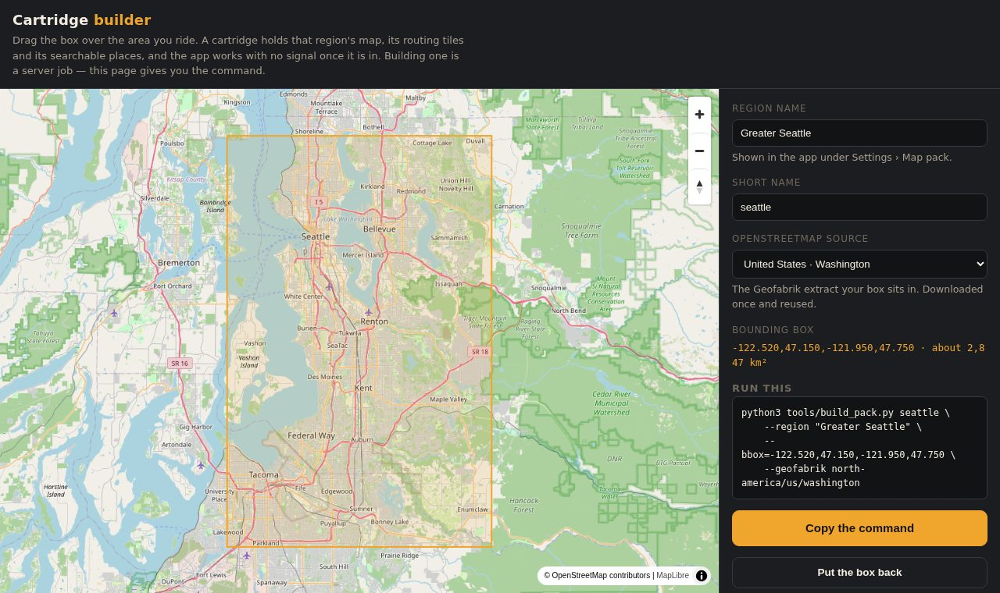

# navipack

Builds offline map packs for **Navi**, a phone navigation app that keeps
working with no signal. A pack (`.navipack`) holds everything the app needs
for one region:

- **the map**: Protomaps vector tiles, zoom 0-14 (`.pmtiles`)
- **the router's tiles**: a Valhalla tile archive (`.tar`)
- **the places list**: a searchable SQLite file of named places, streets and their addresses

Load a pack into the app and you can search for "Goodwill" or "2235 Telegraph
Avenue" and get a route there, with no network at all.

<p align="center"></p>

## Why

A phone has no room and no CPU for a routing graph build, and a browser can't
do one at all. The OSM extract for one metro area is hundreds of megabytes and
the router's tiles take a real machine. So the heavy work is a script on a
computer with disk space and docker. The page above is only a helper: drag a
box over the area you ride and it gives you the command.

## What's here

| Path | What it does |
| --- | --- |
| `web/build.html` | Map page: drag or resize a box, pick the Geofabrik extract, copy the build command. A static file with no server code |
| `tools/build_pack.py` | The whole pipeline for one region. Each stage is skipped when its output already exists, so a run that dies picks up where it stopped |
| `tools/build_places.py` | Named places from an OSM extract: museums, parks, cafes, fuel, stations and more. Each gets a town and a neighbourhood |
| `tools/add_streets.py` | Adds one row per street *and town*, so "Main Street" in two towns are two different results |
| `tools/add_addresses.py` | Gives each place a street address (OSM's own, or "off Telegraph Avenue") so three shops with one name can be told apart |
| `tools/make_pack.py` | Zips the three files into a `.navipack`, MANIFEST first |

### Pack format

A pack is a plain zip, stored (not deflated), whose first entry is always
`MANIFEST`. That way the app can read it while the rest is still streaming in:

```
MANIFEST                        version <hash>, region <name>, then name/size/sha256 per file
bayarea.pmtiles                 the map
bayarea-valhalla-3.6.3.tar      the router's tiles
places.sqlite                   the searchable list
```

The three file names are the same for every region, and the region's name
lives in the MANIFEST. `version` changes whenever any file changes, so loading
a different region always replaces the data and loading the same pack twice
does nothing.

## Install and run

You need Python 3.10+, [osmium-tool](https://osmcode.org/osmium-tool/),
[docker](https://docs.docker.com/engine/install/),
[go-pmtiles](https://github.com/protomaps/go-pmtiles) and `curl`.

```sh
git clone https://github.com/nviiiivn/navipack.git
cd navipack

# pick a box: open web/build.html in a browser (any static server works)
python3 -m http.server -d web 8000     # then visit http://localhost:8000/build.html

# build the pack it gave you
python3 tools/build_pack.py seattle \
    --region "Greater Seattle" \
    --bbox=-122.520,47.150,-121.950,47.750 \
    --geofabrik north-america/us/washington
```

Stages, in order: `map` (pulled from the Protomaps daily build in seconds),
`osm` (Geofabrik extract, cached between runs), `valhalla` (the slow one, run
in the official `valhalla-scripted` container), `places`, then `pack`.
`--only <stage>` runs a single stage.

`make_pack.py` also works on its own if you already have the three files:

```sh
python3 tools/make_pack.py out/seattle.navipack --region "Greater Seattle" \
    --map seattle.pmtiles --tiles seattle-valhalla-3.6.3.tar --places places.sqlite
```

## Configuration

Everything is set with environment variables:

| Variable | Default | What it is |
| --- | --- | --- |
| `NAVIPACK_APP` | the folder above `tools/` | the Navi app source tree (see Status) |
| `NAVIPACK_WORK` | `~/.cache/navipack` | downloads, the Valhalla build and finished packs |
| `NAVIPACK_TMP` | system temp dir | scratch space for osmium exports. Point it at a real disk if `/tmp` is small |
| `PMTILES` | `pmtiles` on `PATH`, else `~/.local/bin/go-pmtiles` | the go-pmtiles binary |

The "Already built" list in `web/build.html` links to packs hosted next to the
page. Change it to list your own.

## Status

These are working tools pulled out of a larger app, and they still lean on it:

- `build_places.py`, `add_streets.py` and `add_addresses.py` import the app's
  own word splitter and road-graph reader (`agedashii_navi.places` from
  `apps/navi`, `agedashii_washi.routing` from `packages/agedashii-washi`). That
  way the pack and the app can never split a name differently. That app
  source isn't public yet, so for now the `places` stage only runs inside an
  app checkout (set `NAVIPACK_APP`). `map`, `osm`, `valhalla` and
  `make_pack.py` run anywhere.
- the "off <street>" fallback in `add_addresses.py` reads a road graph
  (`--graph`, default `assets/maps/bayarea.rg` in the app tree). For other
  regions, pass a graph for that region, or rely on OSM's own addresses.
- `web/build.html` asks for an `icon.png` that isn't in the repo.

## License

[PolyForm Noncommercial 1.0.0](LICENSE). Free to use, change and share for any
noncommercial purpose. Nobody gets to sell it.

Map data © [OpenStreetMap](https://www.openstreetmap.org/copyright)
contributors. Packs you build carry OSM data under the ODbL.
